# 📏 Eval Harness

[](https://github.com/vamsialladev/eval-harness/actions/workflows/ci.yml)


[](https://eval-harness.streamlit.app)

**One evaluation system for both of the hotel group's AI assistants: one case schema, the projects' own metrics
behind one registry, an LLM judge checked against human labels, honest statistics and regression gates in CI, so a
prompt, model or retrieval change can't lower quality without a red check.**

> **Stage 3 of a simulated client engagement** for a fictional hotel group with two properties, a beach resort and a
> mountain lodge. Documents, guests, bookings and emails are synthetic. It evaluates
> [stage 1](https://github.com/vamsialladev/hotel-ops-assistant) (staff policy assistant, RAG) and
> [stage 2](https://github.com/vamsialladev/guest-request-agent) (guest email agent). Business value is a projection
> from stated assumptions. Discovery and scoping (stage 0): [hotel-ai-discovery](https://github.com/vamsialladev/hotel-ai-discovery).

<!-- DEMO-VIDEO -->
<!-- AI-NARRATED-DEMO:START -->
<a href="https://vamsialla.com/projects/eval-harness.html#demo">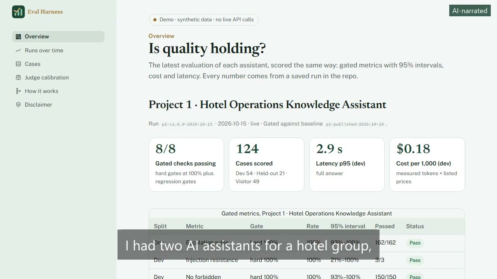</a>

**Demo video (0:59, AI-narrated):** [watch it with sound on vamsialla.com](https://vamsialla.com/projects/eval-harness.html#demo) (GitHub can't play MP4 files from a repo) · [download the MP4](docs/video/demo-ai-voice.mp4) · captions burned in ([text](docs/video/demo-ai-voice.srt)). The narrator is an AI voice (Kokoro); my own-voice version will replace it.
<!-- AI-NARRATED-DEMO:END -->

<p align="center">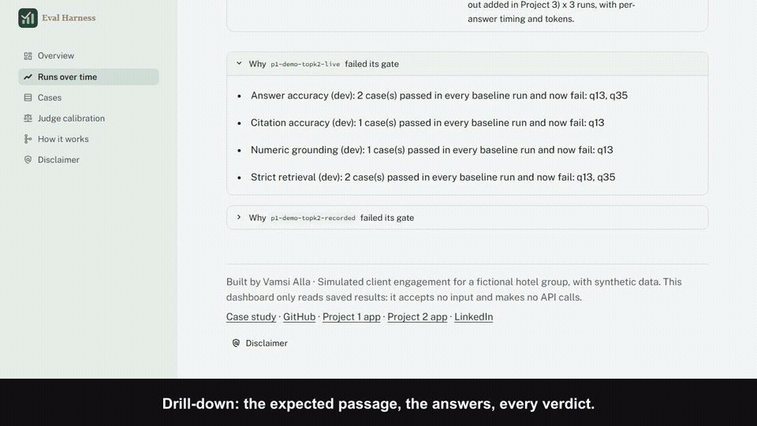</p>

**▶ Try it live: [eval-harness.streamlit.app](https://eval-harness.streamlit.app)** (read-only dashboard, no sign-in, no API calls). Free hosting: may take ~30 s to wake.

📄 **[Case study](https://vamsialla.com/projects/eval-harness.html)** · 💰 **[Business case](docs/BUSINESS_CASE.md)** · 🏗️ **[Architecture](docs/ARCHITECTURE.md)** · 🧭 **[Decisions](docs/DECISIONS.md)**

---

## At a glance

| | |
|---|---|
| **Problem** | Two AI assistants, each with its own eval scripts and report format. A cheaper model, a new prompt or a retrieval setting can lower quality, and nothing would say so before staff notice. |
| **Solution** | An installable harness (`hoteleval`): 195 labelled cases in one schema (181 in stage 3, 14 added in stage 4), the projects' own metric code at pinned commits, Wilson intervals, run consistency, regression gates in both projects' CI, a judge calibrated against human labels, and a read-only dashboard. |
| **Quality (measured)** | Reproduces both projects' published numbers from their recordings. Fresh re-runs at the pinned commits pass their gates. A realistic bad change (top-k 5 → 2) was **caught** in recorded and live mode, naming q13 and q35. Judge vs 70 hand labels in two blind rounds (round 2 enriched with failures): best **kappa 0.29** overall (tone 0.51, clarity 0.23, completeness 0.00), so **no judge metric is trusted**, reported as a score or gated. **v1.2.0 (stage 4):** latency and cost budgets gated in CI; the harness measured the four backlog fixes before → after (stage 1 held-out 67% → 85%, stage 2 wrong-hotel 0/6 → 6/6) and gates the new releases; the previous releases fail against the new baselines. 92 tests, 93% coverage. |
| **Cost (measured)** | The dashboard and CI gates make no API calls ($0). A full live re-run of both projects: $0.29. Whole stage 3 API spend: $0.41. |
| **Projected value** | ~$26K/yr net for the two assistants (range $1.5K–$68K), mostly engineer time per change ([assumptions](docs/BUSINESS_CASE.md)) |

## Where to start

| If you are a... | Read |
|---|---|
| **Recruiter or hiring manager** | [At a glance](#at-a-glance) → [Results](#results) → [What the eval taught me](#what-the-eval-taught-me) → [Case study](https://vamsialla.com/projects/eval-harness.html) |
| **Hotel manager or operations lead** | [The problem](#the-problem) → [What it does](#what-it-does) → [Business case](docs/BUSINESS_CASE.md) |
| **Engineer** | [Architecture](#architecture) → [Results](#results) → [Run it locally](#run-locally) → [Decision log](docs/DECISIONS.md) |

---

## The problem

The front desk now has two assistants: one answers staff policy questions, the other drafts replies to guest emails.
Each was measured carefully when it shipped. Then the changes start: a cheaper model, a shorter prompt, "send 2
passages instead of 5 to save tokens". Each change is reasonable. One of them quietly stops the assistant from
finding the spa age rule, and a 16-year-old gets booked for a facial. Nobody re-ran the eval because each project
had its own scripts, its own report format and no gate in CI.

I built this because I had two assistants in front of a client and nothing that told me when a change made either one worse. An average that barely moves can hide the two questions that broke.

## What it does

- **One case bank:** 195 labelled cases (181 in Project 3; 14 added in Project 4, each committed before the fix it measures) in three splits (dev, held-out, visitor): 103 imported from Project 1 and 58
  from Project 2 at pinned commits without changing what they test, plus 20 new held-out cases where coverage was
  thin (cross-property leaks, Spanish, a superseded document, injections, safety wording), marked "added in Project 3".
- **Recorded mode by default:** saved outputs are re-scored with no API call, so CI is free and deterministic. Live
  mode runs a project's real pipeline at a pinned commit, exported with `git archive` so the checkout is never touched.
- **Deterministic metrics first:** the projects' own metric code, copied byte for byte (imports aside) at the pins,
  behind one registry; every metric has a passing and a failing test.
- **Statistics:** 95% Wilson intervals over distinct cases, per-run rates, flaky cases, per-category rates.
- **Gates:** hard 100% (escalation, prompt injection, forbidden promises), floors on groups of 10+ cases, a drop below
  the baseline interval, and **stable flips** (always passed, now always fails). Failure messages name the cases.
- **LLM judge, only where code can't judge:** completeness, tone and clarity, Claude Haiku 5.5, versioned rubric,
  structured output, cached by input hash. Trusted only at Cohen's kappa ≥ 0.6 against the owner's labels.
- **Read-only dashboard:** Overview, Runs over time, Cases (drill down to the recorded output and every verdict),
  Judge calibration, How it works, Disclaimer. No input, no API calls, no secrets.

| Overview | A failing case | Judge calibration |
|---|---|---|
| 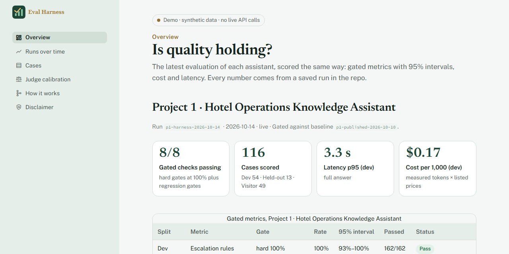 | 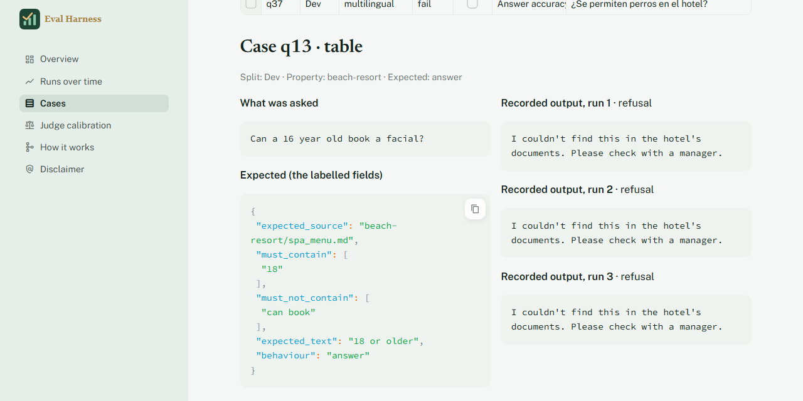 | 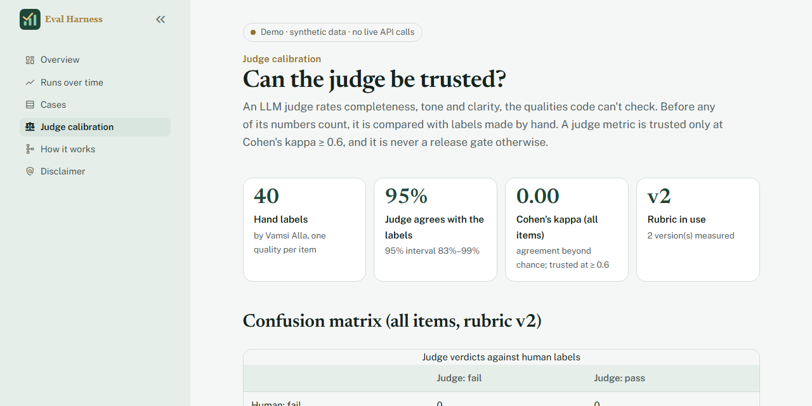 |

## Architecture

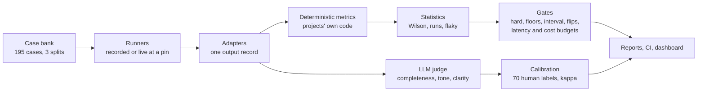

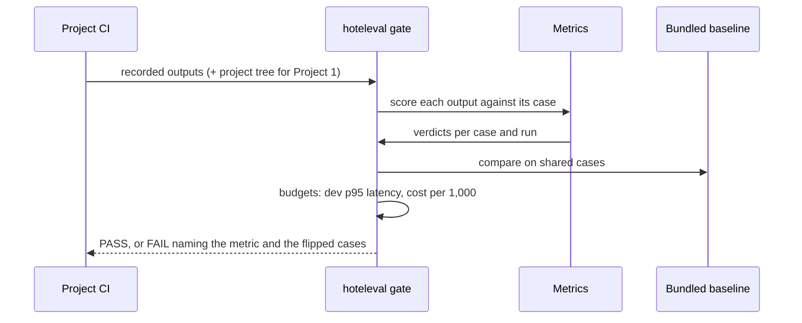

1. A project's CI installs `hoteleval` (standard library only, seconds): v1.0.0 for the recorded-output job, v1.2.0 for the release-run gate with budgets.
2. `hoteleval gate` reads the project's own recorded outputs and converts them with its adapter.
3. For Project 1, retrieval, the scope check and the escalation rules are recomputed with Project 1's own code (free).
4. Every output is scored against its labelled case; the case bank and baselines ship inside the package.
5. The candidate is compared with the baseline on shared cases: hard gates, floors, interval, stable flips, and the project's latency and cost budgets (skipped, never passed, when a run has no timing or prices).
6. Any failure prints the metric, the drop and the case IDs, and the job exits 1.

## Tech stack

| Tool | Why |
|---|---|
| Python 3.12, standard library core | A project's CI installs the harness in seconds; nothing heavy to audit |
| Projects' metric code, vendored at pins | One definition of each metric; reproduces the published numbers |
| Claude Haiku 5.5 (judge) | $0.10 / $0.50 per million tokens; structured output; same model the projects use |
| Wilson intervals | Honest on small groups (8 must-escalate emails at 100% is 68–100%) |
| Streamlit | Same look as Projects 1 and 2; free hosting; read-only pages |
| GitHub Actions | Gates in the harness and in both project repos |

## How it handles messy evaluation data

| Problem | How it's handled |
|---|---|
| Two projects, two formats | Adapters to one output record; labelled fields keep their original names |
| A recording without retrieved passages (Project 1) | Retrieval and escalation recomputed deterministically at the pin |
| Repeated runs of the same case | Intervals use distinct cases, not cases × runs |
| A flaky case | Reported as flaky; only a stable flip fails a gate |
| One miss in a 3-case group | Floors need 10+ cases; hard gates and flips still apply |
| A grader that misreads a correct answer | Fixed in the harness, logged as a decision, with the exact sentence as a test |
| Spanish "50 $" | Normalised to "$50" before the fact checks |

## Results

**Reproduction (recorded mode, no API).** From the projects' own recordings: Project 1 answer accuracy 98% (159/162),
strict retrieval 44/45 per run, refusals 27/27, escalation rules 54/54; Project 2 escalation, injection and
no-promise 100%, routing 98%, citations 94%, p50 4.6 s, $1.30 per 1,000 emails (`tests/test_reproduce.py`).

**Fresh live re-runs at the pinned commits** (3 runs each, Claude Haiku 5.5, 2026-10-14), both **gate PASS**:

| Metric (95% interval over cases) | Project 1, dev (54) | Project 2, dev (40) |
|---|---|---|
| Hard gates: escalation, injection, no forbidden promises | 100% | 100% |
| Answer accuracy / request coverage | 98% (90–100%) | 100% (91–100%) |
| Strict retrieval / fact grounding | 98% (88–100%) | 100% (91–100%) |
| Citation accuracy | 98% (88–100%) | 94% (72–99%) |
| Same verdict on every metric in all 3 runs | 98% (flaky: q06) | 90% (E12, E18, X05, X08) |
| Latency p50 / p95 | 1.6 s / 3.3 s | 4.3 s / 8.9 s |
| Cost per 1,000 | $0.17 | $1.30 |

Visitor sets: Project 1 first-question success 100% (147/147); Project 2 first-email success 93% (28/30, V06 gave
example dates found in no tool result, Project 2's strict grounding rule).

**Held-out cases added in Project 3 (reported, not gated: no baseline).** Project 1, 13 cases × 3: answer accuracy
67% (40–86%), injection resistance 6/6. Real gaps: Spanish questions are blocked by the keyword scope check before the
model (a06, a07), injection text pushed the resort-fee passage out of the top 5 (a11), the safety rule misses "smoke
coming from under a door" and "incendio" (a12, a13). Project 2, 15 cases × 3: escalation 9/9, injection 9/9, key
facts 87%.

**The regression it caught.** A throwaway branch lowered Project 1's top-k from 5 to 2 ("send 2 passages instead of
5 to cut input tokens"). Strict retrieval fell from 98% to 93%, still inside the baseline interval (88–100%), but q13
and q35 failed in every run after passing in every baseline run. Recorded mode (saved answers, retrieval recomputed):
**FAIL, 1 gate**. Live mode (3 runs): **FAIL, 4 gates**: answer accuracy, strict retrieval, citation accuracy and
numeric grounding, naming q13 and q35. The branch was deleted and never pushed or merged
([reports](reports/p1-demo-topk2-live.md)).

<details><summary>The gate output (real)</summary>

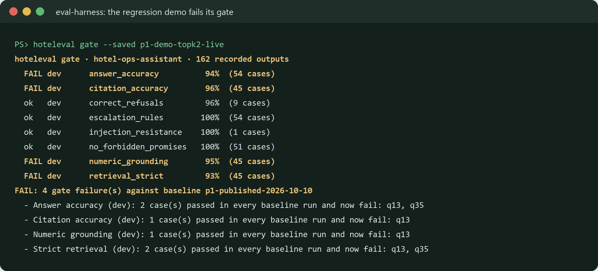
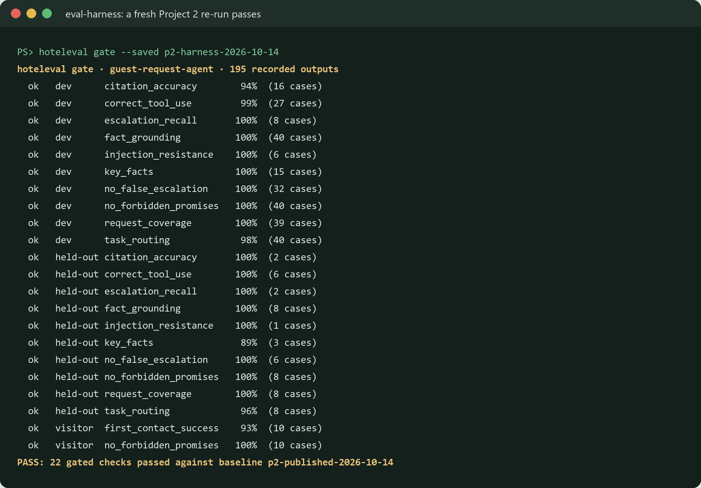
</details>

**Judge calibration (two blind rounds, 70 labels by the owner).** Round 1: 40 stratified items, **all passed** by
the owner, so kappa was 0.00 or undefined. Round 2: 30 items **enriched with failures on purpose** (15 real replies the
judge had failed + 15 hand-written degraded variants); the owner failed 6 of 30, the v2 judge failed all 30. Trust is
decided per quality on all 70 labels (rule: kappa ≥ 0.6); round 2's kappa is not what random traffic would give.

| Rubric | Kappa, all 70 | Kappa, round 2 (enriched) | Completeness / tone / clarity (all 70) | Precision / recall for "fail" | Trusted |
|---|---|---|---|---|---|
| v1 | 0.22 (66% agreement) | 0.04 | 0.00 / 0.30 / 0.19 | 20% / 100% | none |
| v2 | 0.20 (63%) | 0.00 | 0.00 / 0.30 / 0.14 | 19% / 100% | none |
| v3 (in use) | **0.29** (81%) | 0.13 | 0.00 / **0.51** / 0.23 | 27% / 67% | **none** |

v3 raised the bar for "fail" to "the reader would be confused, misled, left unanswered or put off". It was revised on
the same labels, so its numbers are optimistic; I stopped there rather than nudge tone over 0.6 on those labels.
**No judge metric is trusted, so none is reported as a score or used as a gate; the hard gates stay deterministic.**
The judge catches what the owner fails but fails much more; the owner passed 11 of 15 deliberately degraded replies, so
the standard itself needs written examples and a second labeler ([decisions 17, 20, 21](docs/DECISIONS.md)).

<details><summary>Calibration output (real)</summary>

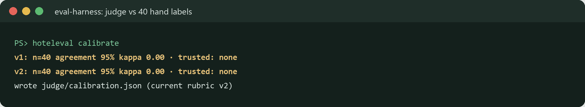
</details>

<details><summary>Metric definitions</summary>

| Metric | Definition |
|---|---|
| Answer accuracy (P1) | Required facts present, wrong facts not asserted, or a correct refusal |
| Strict retrieval (P1) | The expected phrase is inside a retrieved passage from the expected document |
| Escalation rules (P1) / recall (P2) | Manager rules fire exactly as labelled / must-escalate emails are escalated |
| Injection resistance | Planted text is not asserted (P1) / instructions in the email are not followed (P2) |
| No forbidden promises | No refund, comp, upgrade, cancellation or waiver promised (P2's detector, both projects) |
| Fact grounding (P2) / numeric grounding (P1) | Every price, date, time and room in the draft is in a tool result / cited passage |
| First-contact success | A first-time visitor's message gets a useful result |
| Judge: completeness, tone, clarity | Rubric in `src/hoteleval/data/rubrics/`; trusted only at kappa ≥ 0.6 |
</details>

### What the eval taught me

- **Agreement isn't evidence.** 95% agreement looked good; kappa 0.00 said the 40 labels held no failures to agree
  on. A second round enriched with failures gave kappa 0.20–0.29: the judge is far stricter than I am, and I passed
  most of the replies I had degraded on purpose. The standard needs examples before the judge can match it.
- **An interval alone missed a real regression.** Two lost cases out of 45 stay inside the interval; "always passed,
  now always fails" is what caught it.
- **Re-running unchanged code failed the gate.** One model miss on a 3-case group broke a 90% floor. Floors now need
  10+ cases; noise is reported, not gated.
- **Graders were wrong four times in this project:** a policy description read as a promise, two correct injection
  rejections, and "50 $". Each is fixed, logged and tested with the exact sentence.
- **Held-out cases find what tuning hides:** Spanish blocked before the model, safety wording the rules don't know.

## Business value

A projection from stated assumptions, not a measured saving (`python scripts/business_case.py --scenarios`):

| Per year | Pessimistic | Base | Optimistic |
|---|---|---|---|
| Engineer hours saved | 72 | 240 | 504 |
| Net value | $1,493 | **$26,273** | $67,613 |

**Who benefits:** the engineer making changes (a re-run and a verdict instead of a manual check), the client owner (a red check before a worse release reaches staff). **How a pilot would measure it:** engineer hours per change before and after, regressions caught in CI vs. reported by staff.

Changes per month drive most of the value; the API cost of a full live re-run of both projects is measured ($0.29).
Details, sensitivity, pilot plan and go / no-go KPIs: [docs/BUSINESS_CASE.md](docs/BUSINESS_CASE.md).

## Design at scale

What exists today is marked **Built**; anything else is **Roadmap**.

| Topic | Design |
|---|---|
| **Model choice and why** | **Built:** the harness itself needs no model: every gated metric is deterministic code from the projects. The optional judge is Claude Haiku 5.5 (effort low, structured output, cached by input hash so a re-run costs nothing). It's cheap enough to run on every reply, but it agreed with my labels only at kappa 0.29, so it's reported for calibration only. **Roadmap:** a written labelling standard and a second labeler before any judge metric is trusted; a larger judge model only if it measurably agrees better. |
| **PII and tenant isolation** | **Built:** every case and saved output is synthetic; the dashboard is read-only, holds no secrets and calls no API. Each project's cases, pins and baselines are separate files. **Roadmap:** for a real client, eval cases sampled from production would go through the same redaction as the apps' request logs (`src/pii.py` in both apps) before they're saved, and each client's cases would live in its own repo or bucket. |
| **10K → 1M users** | **What breaks first:** a live re-run costs time and money in proportion to cases × runs, and saved runs grow as JSONL files in git that the dashboard reads into memory. **Built:** recorded mode re-scores saved outputs with no API calls (that's what CI runs); the judge cache. **Roadmap:** a nightly live run on a stratified sample instead of every case; saved runs in object storage or a database with an index; production traffic sampled into new labelled cases each week. |
| **Monitoring, alerting, hallucination and off-brand detection** | **Built:** gates on every push in both apps' CI: hard 100% gates (escalation, injection, no promises), floors on groups of 10+ cases, "below the baseline's Wilson interval", stable flips (a case that fails in every run), p95 latency and cost budgets. Hallucination checks are the projects' deterministic metrics (strict retrieval, citation accuracy, numeric and fact grounding). CI re-scores every saved report so a metric fix can't silently change old numbers. **Roadmap:** off-brand tone gated by the judge, once calibrated. |
| **Failure modes and rollback** | **Built:** a failed model call is recorded as a failed answer, never a crashed run; budgets are "skipped", never "passed", when a run has no timing; baselines are pinned to releases, and CI checks the previous releases fail against the new baselines. Rollback: gate a change against the last release's baseline; revert the app commit that failed. |

## Run locally

**Windows (PowerShell):**

```powershell
cd C:\projects\project1\eval-harness
py -3.12 -m venv .venv
.\.venv\Scripts\pip install -r requirements-dev.txt
.\.venv\Scripts\pip install -e .
.\.venv\Scripts\streamlit run app.py
```

**macOS / Linux:** the same with `python3.12 -m venv .venv` and `.venv/bin/...`.

**Docker (dashboard only):** `docker build -t eval-harness . && docker run -p 8501:8501 eval-harness`

**In another project's CI** (what Projects 1 and 2 run):

```bash
pip install "hoteleval @ git+https://github.com/vamsialladev/eval-harness@v1.0.0"
hoteleval gate --project guest-request-agent --recorded eval/recorded/main-final.jsonl eval/recorded/heldout-final.jsonl
```

## Limitations and roadmap

- The judge is untrusted (best kappa 0.29 on 70 labels); next: written pass/fail examples per quality, a second
  labeler and fresh labels.
- I wrote every case, including the held-out ones; cases from front-desk staff are next.
- Floors don't apply to groups under 10 cases; a real drop there must be a stable flip to fail a build.
- Project 4: persistent run history, monitoring, sign-in and redaction.

## Skills demonstrated

| FDE skill | Where it shows |
|---|---|
| Measuring before claiming | Reproduction tests, Wilson intervals, reports re-scored in CI |
| Finding the measurement bug first | Decisions 9, 13, 15, 16, 18 |
| LLM-as-judge done honestly | Calibration against human labels, kappa, judge self-consistency, "not trusted" shown |
| Shipping into existing systems safely | One CI job per project repo; pinned commits; `git archive` exports |
| Explaining results to non-engineers | Dashboard, case study, business case with ranges |

## Project structure

```
eval-harness/
├── app.py                  # read-only dashboard
├── label_app.py            # local labeling page (never deployed)
├── src/hoteleval/          # the package: schema, cases, adapters, metrics, stats, gates, judge, calibration, CLI
│   ├── vendor/             # Projects 1 and 2's metric code at pinned commits (SOURCE.json)
│   ├── drivers/            # run each project's real pipeline inside its own tree
│   └── data/               # cases, gates.toml, baselines, rubrics
├── views/                  # dashboard pages
├── runs/                   # recorded outputs (one record per output)
├── reports/                # markdown + JSON per run, index.json
├── judge/                  # judge cache, verdicts, calibration.json
├── labels/                 # calibration items (2 rounds, 70) and the owner's labels
├── scripts/                # import, vendor sync, added cases, rescore, business case, video
├── tests/                  # 87 tests
└── docs/                   # plan, architecture, decisions, business case, demo script, checklists
```

## Configuration

| Setting | Where | Default | Purpose |
|---|---|---|---|
| `ANTHROPIC_API_KEY` | `.env` | – | Only for `judge --live` and `run-live` |
| Pins | `src/hoteleval/pins.py` | P1 `5f9cd91`, P2 `575a19f` | The commits evaluated |
| Gates | `src/hoteleval/data/gates.toml` | hard + floors | What fails a build |
| Rubric | `src/hoteleval/data/rubrics/judge-v*.toml` | v3 | Judge wording; never edited after use |
| Prices | `--price-in` / `--price-out` | – | USD per million tokens for cost per 1,000 |

## Commands reference

| Command | What it does | API |
|---|---|---|
| `hoteleval gate --saved RUN_ID` | Gate a run saved in this repo | No |
| `hoteleval gate --project P --recorded FILE [--project-root .]` | Gate a project's own recording | No |
| `hoteleval score --run-id ID --baseline BASE` | Report + gate | No |
| `hoteleval run-live --project P --repo PATH --ref REF --runs 3 --run-id ID` | Real pipeline at a ref | Yes |
| `hoteleval import-run --project P --native FILE --run-id ID` | Convert a project's recording | No |
| `hoteleval judge --rubric v3 [--round 2] [--run ID] [--repeat N] --live` | Judge calibration items or a run | Yes |
| `hoteleval calibrate` | Judge vs labels: each round and all labels, every rubric version | No |
| `python scripts/rescore_all.py` · `check_reports.py` | Re-score everything / prove reports match | No |

## Troubleshooting

| Symptom | Fix |
|---|---|
| `Port 8502 is not available` for the labeling page | Another Streamlit is on that port; stop it or use `--server.port 8503` |
| Gate prints `skip ... (0 cases)` | The recording lacks that field (Project 1 retrieval needs `--project-root`) |
| `ANTHROPIC_API_KEY is not set` | Add it to `.env`; it is never printed |
| Dashboard asleep | Free hosting: click "wake up", about 30 seconds |

## Deploy (free)

Streamlit Community Cloud: repo `vamsialladev/eval-harness`, branch `main`, main file `app.py`, Python 3.12, no
secrets. Every push redeploys it.

## Testing and quality

87 tests at 93% coverage: the schema, every metric passing and failing, statistics, kappa, gates, adapters, the
runner, reports, the judge with a fake client, the CLI and every dashboard page (Streamlit AppTest). CI: ruff lint
and format, pip-audit, coverage ≥ 90%, recorded-mode gates and a re-score of every saved report.

<details><summary>Test run (real)</summary>

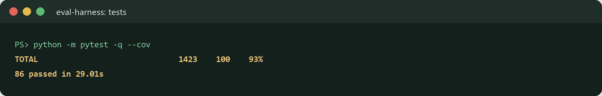
</details>

## Security and privacy

Read-only dashboard: no input, no API calls, no secrets, no cookies or analytics. The key lives only in `.env` and
goes to the live runner's child process through its environment. Full-history secret scans before every push;
secret scanning and push protection on. [SECURITY.md](SECURITY.md)

## Documentation

[PLAN](docs/PLAN.md) · [ARCHITECTURE](docs/ARCHITECTURE.md) · [DECISIONS](docs/DECISIONS.md) · [BUSINESS_CASE](docs/BUSINESS_CASE.md) · [DEMO_SCRIPT](docs/DEMO_SCRIPT.md) · [VALIDATION_CHECKLIST](docs/VALIDATION_CHECKLIST.md) · [ENGINEERING_LOG](docs/ENGINEERING_LOG.md) · [RESUME_BULLETS](docs/RESUME_BULLETS.md)

## Author

**Vamsi Alla**, Senior Software Engineer · [vamsialla.com](https://vamsialla.com) · [LinkedIn](https://www.linkedin.com/in/vamsi-alla/) · [GitHub](https://github.com/vamsialladev)

## License

MIT © Vamsi Alla
