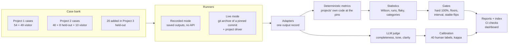
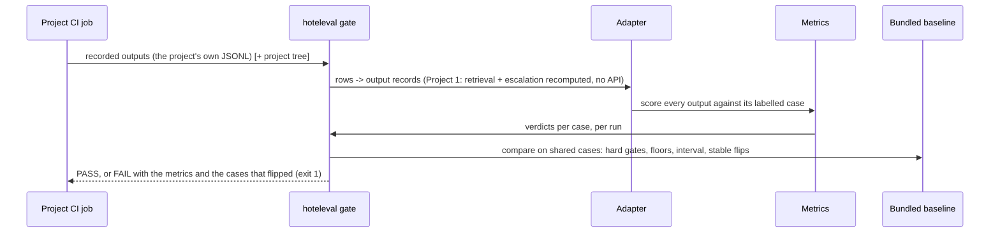

# Architecture

## System

## Request flow: one candidate run in CI

1. The project's CI checks out the project and installs `hoteleval` at tag v1.0.0 (standard library only).
2. `hoteleval gate` reads the project's recorded outputs and converts each row with the project's adapter.
3. Project 1 rows lack retrieved passages, so the Project 1 driver recomputes retrieval, the scope check and the
   escalation rules with the project's own code (deterministic, free).
4. Every output is scored by the metric registry against its case; the case bank ships inside the package.
5. The run is compared with the bundled baseline on the cases both share, metric by metric.
6. Any failure prints the metric, the drop and the flipped case IDs, and the job exits 1.

## Components

| Component | File | Responsibility |
|---|---|---|
| Case schema | `src/hoteleval/schema.py` | Shared fields + project-labelled `expected`, validation, `native()` view |
| Case import | `src/hoteleval/importers.py`, `scripts/import_cases.py` | Projects' cases at pinned commits, unchanged in meaning |
| Added cases | `scripts/write_added_cases.py` | 20 held-out cases where coverage was thin |
| Pins | `src/hoteleval/pins.py` | The project commits the harness evaluates |
| Vendored metrics | `src/hoteleval/vendor/`, `scripts/sync_vendor.py` | The projects' metric code, byte for byte except imports |
| Metric registry | `src/hoteleval/metrics.py` | One `(case, output) -> pass/fail/None` function per metric |
| Adapters | `src/hoteleval/adapters.py` | Project rows -> one output record |
| Runners | `src/hoteleval/runner.py`, `drivers/` | Live runs at a ref in an exported tree; Project 1 deterministic recompute |
| Statistics | `src/hoteleval/stats.py` | Wilson intervals, percentiles, consistency, flaky cases, kappa |
| Scoring | `src/hoteleval/scoring.py` | Per split: metrics, categories, latency, cost |
| Gates | `src/hoteleval/gates.py`, `data/gates.toml` | Candidate vs baseline |
| Reports | `src/hoteleval/report.py`, `store.py` | Markdown + JSON per run, run index |
| Judge | `src/hoteleval/judge.py`, `data/rubrics/` | Versioned rubric, structured output, cache by input hash |
| Calibration | `src/hoteleval/calibration.py`, `labeling.py`, `label_app.py` | Stratified items, human labels, agreement and kappa |
| Dashboard | `app.py`, `views/` | Read-only pages over the saved files |

## Scaling path

- **More projects:** one adapter, one driver, a pin and a gates entry (Projects 4 and 5 plug in the same way).
- **More cases:** the bank is JSONL; scoring 500 cases is still well under a second without the API.
- **Larger live runs:** the drivers write one line per output and resume nothing yet; for thousands of cases, use the
  Message Batches API (half price, asynchronous) in the drivers.
- **More labels:** the labeling page and calibration code don't change; a second labeler adds inter-annotator
  agreement, which is the ceiling a judge can be expected to reach.
- **Persistent history:** reports are files in git today; Project 4 moves run history to a database with retention.
